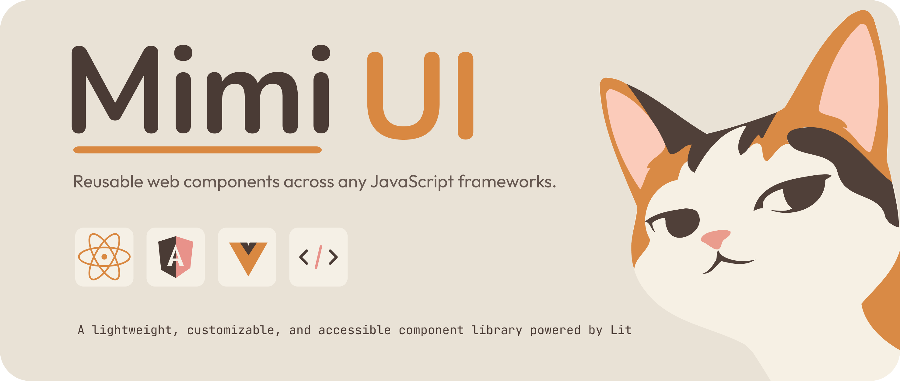

<div align="center">

  

  <h3>Mimi UI</h3>

  <p>Reusable web components across any JavaScript framework.</p>

  <p>
    A lightweight, customizable, and accessible component library
    powered by <a href="https://lit.dev">Lit</a>.
  </p>

  <p>
    <a href="https://www.npmjs.com/package/@first-apps/mimi-ui/" target="_blank">
      
    </a>&nbsp;
    <a href="https://lit.dev/" target="_blank">
      
    </a>&nbsp;
    <a href="https://github.com/first-apps/mimi-ui/blob/master/LICENSE" target="_blank">
      
    </a>&nbsp;
    <a href="https://first-apps.github.io/mimi-ui/" target="_blank">
      
    </a>&nbsp;
    <a href="https://github.com/first-apps/mimi-ui/" target="_blank">
      
    </a>
  </p>

</div>

---

## Install

```bash
npm install @first-apps/mimi-ui
```

## Usage

`@first-apps/mimi-ui` exposes typed framework entrypoints. Pick the subpath that
matches your stack — every entrypoint is a regular import, no bundler
plugin needed.

### Detailed Usage Examples
<div align="left">
  <p align="left">
    <a href="https://first-apps.github.io/mimi-ui/" target="_blank">
      
    </a>
  </p>
</div>

> Four entrypoints ship: the vanilla web-components (`@first-apps/mimi-ui`),
> plus React, Vue, and Angular wrappers. For the raw custom elements without
> a wrapper, see
> [Plain usage](https://github.com/first-apps/mimi-ui/blob/master/docs/PLAIN_USAGE.md).

### Plain HTML

```html
<script type="module">
  import '@first-apps/mimi-ui'; // registers <m-button>
</script>

<m-button variant="primary" size="md">Save changes</m-button>
```

### React 18+

```tsx
import { MButton } from '@first-apps/mimi-ui/react';

export function SaveButton() {
  const onClick = () => {
    // …
  };

  return (
    <MButton variant="primary" onClick={onClick}>
      Save
    </MButton>
  );
}
```

`onClick` is the native click. Use `onMButtonClick` for the component's own
event, which carries a typed payload:

```tsx
import { MButton, type MButtonClickDetail } from '@first-apps/mimi-ui/react';

<MButton
  variant="primary"
  onMButtonClick={(e: CustomEvent<MButtonClickDetail>) => {
    // e.detail.source → the <m-button> element
  }}
/>;
```

### Vue 3.4+

```vue
<script setup lang="ts">
import { MButton } from '@first-apps/mimi-ui/vue';

function onSave() {
  // …
}
</script>

<template>
  <MButton variant="primary" @click="onSave">Save</MButton>
</template>
```

The `icon` slot is forwarded too:

```vue
<MButton variant="primary">
  <template #icon><span aria-hidden="true">★</span></template>
  Add to favorites
</MButton>
```

### Angular 18+

```ts
import { Component, CUSTOM_ELEMENTS_SCHEMA } from '@angular/core';
import '@first-apps/mimi-ui';

@Component({
  selector: 'app-save',
  standalone: true,
  schemas: [CUSTOM_ELEMENTS_SCHEMA],
  template: `<m-button variant="primary" (click)="onSave()">Save</m-button>`,
})
export class SaveComponent {
  onSave() {
    // …
  }
}
```

---

[MIT licensed](https://github.com/first-apps/mimi-ui/blob/master/LICENSE) © 2026 mimi-ui contributors · [GitHub repo →](https://github.com/first-apps/mimi-ui)
